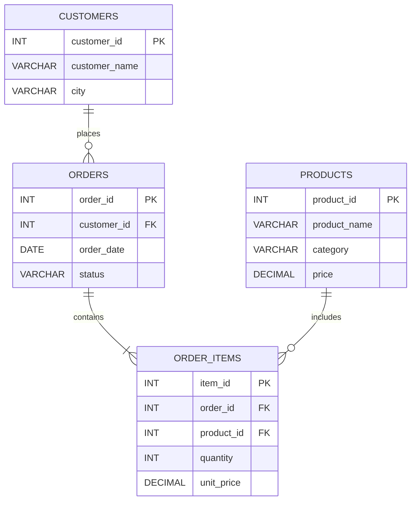

# E-Commerce Sales Analysis Using MySQL

**Project by:** Basheerunnisa  
**Database:** MySQL  
**Tool:** MySQL Workbench

## 1. Project Overview

This project analyzes e-commerce data using MySQL. It stores customer details, product information, orders, and order items. SQL queries are used to analyze sales, customer activity, product performance, and order status.

## 2. Database Tables

| Table | Description |
|---|---|
| `customers` | Customer details |
| `products` | Product information |
| `orders` | Customer order details |
| `order_items` | Products and quantities in each order |

## 3. ER Diagram



## 4. Complete SQL Code — Create Tables

```sql
CREATE DATABASE IF NOT EXISTS ecommerce_db;

USE ecommerce_db;

CREATE TABLE IF NOT EXISTS customers (
    customer_id INT PRIMARY KEY,
    customer_name VARCHAR(50),
    city VARCHAR(50)
);

CREATE TABLE IF NOT EXISTS products (
    product_id INT PRIMARY KEY,
    product_name VARCHAR(50),
    category VARCHAR(50),
    price DECIMAL(10,2)
);

CREATE TABLE IF NOT EXISTS orders (
    order_id INT PRIMARY KEY,
    customer_id INT,
    order_date DATE,
    status VARCHAR(20),
    FOREIGN KEY (customer_id)
        REFERENCES customers(customer_id)
);

CREATE TABLE IF NOT EXISTS order_items (
    item_id INT PRIMARY KEY,
    order_id INT,
    product_id INT,
    quantity INT,
    unit_price DECIMAL(10,2),
    FOREIGN KEY (order_id)
        REFERENCES orders(order_id),
    FOREIGN KEY (product_id)
        REFERENCES products(product_id)
);
```

## 5. Insert Sample Data

```sql
INSERT INTO customers VALUES
(1, 'Rahul', 'Hyderabad'),
(2, 'Priya', 'Vijayawada'),
(3, 'Asha', 'Guntur'),
(4, 'Kiran', 'Hyderabad'),
(5, 'Ravi', 'Guntur');

INSERT INTO products VALUES
(101, 'Laptop', 'Electronics', 50000),
(102, 'Mobile', 'Electronics', 20000),
(103, 'Headphones', 'Accessories', 2000),
(104, 'Keyboard', 'Accessories', 1500),
(105, 'Mouse', 'Accessories', 800);

INSERT INTO orders VALUES
(1001, 1, '2026-01-10', 'Delivered'),
(1002, 2, '2026-01-12', 'Delivered'),
(1003, 3, '2026-02-05', 'Pending'),
(1004, 1, '2026-02-15', 'Delivered'),
(1005, 4, '2026-03-01', 'Cancelled');

INSERT INTO order_items VALUES
(1, 1001, 101, 1, 50000),
(2, 1001, 103, 2, 2000),
(3, 1002, 102, 1, 20000),
(4, 1003, 104, 2, 1500),
(5, 1004, 103, 1, 2000),
(6, 1004, 105, 2, 800),
(7, 1005, 102, 1, 20000);
```

## 6. SQL Queries with Outputs

### Query 1: Display All Customers

```sql
SELECT * FROM customers;
```

**Output**

| customer_id | customer_name | city |
|---:|---|---|
| 1 | Rahul | Hyderabad |
| 2 | Priya | Vijayawada |
| 3 | Asha | Guntur |
| 4 | Kiran | Hyderabad |
| 5 | Ravi | Guntur |

### Query 2: Display All Products

```sql
SELECT * FROM products;
```

**Output**

| product_id | product_name | category | price |
|---:|---|---|---:|
| 101 | Laptop | Electronics | 50000 |
| 102 | Mobile | Electronics | 20000 |
| 103 | Headphones | Accessories | 2000 |
| 104 | Keyboard | Accessories | 1500 |
| 105 | Mouse | Accessories | 800 |

### Query 3: Find Total Number of Orders

```sql
SELECT COUNT(*) AS total_orders
FROM orders;
```

**Output**

| total_orders |
|---:|
| 5 |

### Query 4: Calculate Total Sales

```sql
SELECT SUM(quantity * unit_price) AS total_sales
FROM order_items;
```

**Output**

| total_sales |
|---:|
| 100600 |

### Query 5: Find Sales from Delivered Orders

```sql
SELECT SUM(oi.quantity * oi.unit_price) AS delivered_sales
FROM order_items oi
JOIN orders o
    ON oi.order_id = o.order_id
WHERE o.status = 'Delivered';
```

**Output**

| delivered_sales |
|---:|
| 77600 |

### Query 6: Find the Most Expensive Product

```sql
SELECT *
FROM products
ORDER BY price DESC
LIMIT 1;
```

**Output**

| product_id | product_name | category | price |
|---:|---|---|---:|
| 101 | Laptop | Electronics | 50000 |

### Query 7: Find Customer Order Details

```sql
SELECT
    c.customer_name,
    o.order_id,
    o.order_date,
    o.status
FROM customers c
JOIN orders o
    ON c.customer_id = o.customer_id
ORDER BY o.order_date;
```

**Output**

| customer_name | order_id | order_date | status |
|---|---:|---|---|
| Rahul | 1001 | 2026-01-10 | Delivered |
| Priya | 1002 | 2026-01-12 | Delivered |
| Asha | 1003 | 2026-02-05 | Pending |
| Rahul | 1004 | 2026-02-15 | Delivered |
| Kiran | 1005 | 2026-03-01 | Cancelled |

### Query 8: Count Orders by Status

```sql
SELECT
    status,
    COUNT(*) AS total_orders
FROM orders
GROUP BY status;
```

**Output**

| status | total_orders |
|---|---:|
| Cancelled | 1 |
| Delivered | 3 |
| Pending | 1 |

### Query 9: Find Customers from Hyderabad

```sql
SELECT *
FROM customers
WHERE city = 'Hyderabad';
```

**Output**

| customer_id | customer_name | city |
|---:|---|---|
| 1 | Rahul | Hyderabad |
| 4 | Kiran | Hyderabad |

### Query 10: Find Products Costing More Than 5000

```sql
SELECT *
FROM products
WHERE price > 5000;
```

**Output**

| product_id | product_name | category | price |
|---:|---|---|---:|
| 101 | Laptop | Electronics | 50000 |
| 102 | Mobile | Electronics | 20000 |

### Query 11: Find the Cheapest Product

```sql
SELECT *
FROM products
ORDER BY price ASC
LIMIT 1;
```

**Output**

| product_id | product_name | category | price |
|---:|---|---|---:|
| 105 | Mouse | Accessories | 800 |

### Query 12: Find Delivered Orders

```sql
SELECT *
FROM orders
WHERE status = 'Delivered';
```

**Output**

| order_id | customer_id | order_date | status |
|---:|---:|---|---|
| 1001 | 1 | 2026-01-10 | Delivered |
| 1002 | 2 | 2026-01-12 | Delivered |
| 1004 | 1 | 2026-02-15 | Delivered |

## 7. Project Results

| Analysis | Result |
|---|---:|
| Total orders | 5 |
| Total sales across all order items | 100600 |
| Sales from delivered orders | 77600 |
| Most expensive product | Laptop |
| Cheapest product | Mouse |
| Customers with no orders | Ravi |
| Delivered orders | 3 |
| Pending orders | 1 |
| Cancelled orders | 1 |

*Note:* Total sales includes items from Delivered, Pending, and Cancelled orders. Delivered sales includes only Delivered orders.

## 8. SQL Concepts Used

- Database and table creation
- Primary Key and Foreign Key
- INSERT and SELECT
- WHERE, ORDER BY, LIMIT
- Aggregate functions: COUNT(), SUM()
- GROUP BY
- INNER JOIN
- Filtering and sorting

## 9. Conclusion

This project demonstrates how MySQL can be used to manage e-commerce data and analyze sales, customers, products, and order status. It provides practical experience with relational database design, joins, aggregate functions, and SQL queries.
